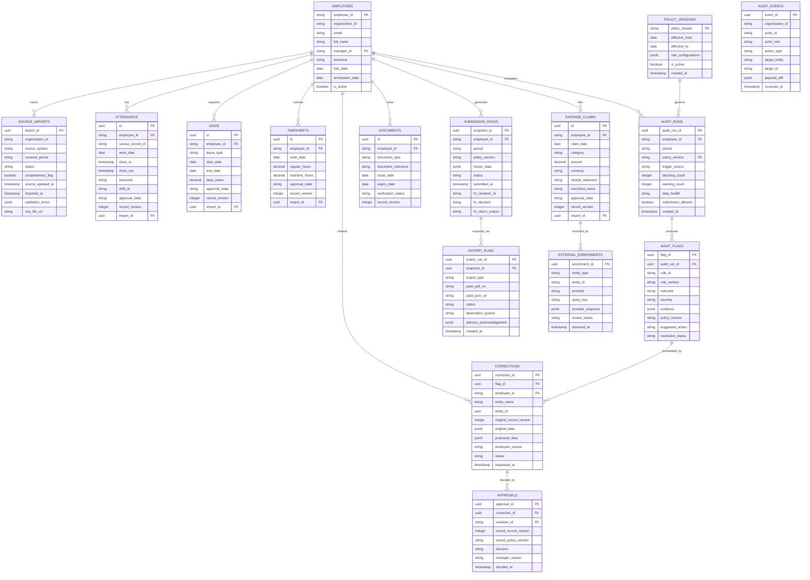
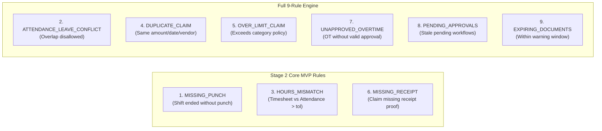
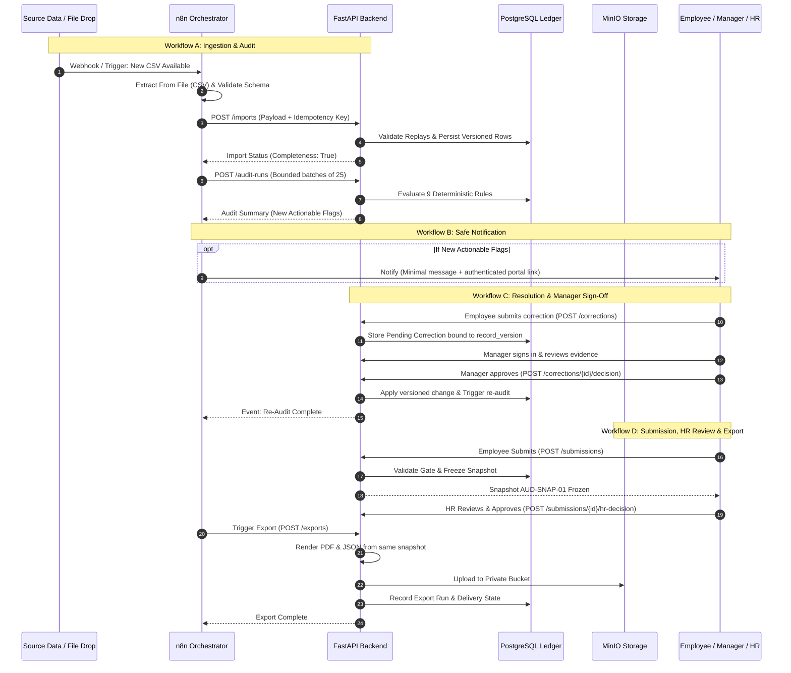

# Month-End HR Self-Audit Assistant — Implementation Plan & System Architecture

**Document Version:** 1.0.0  
**Status:** Pending User Approval  
**Reference Specification:** [HR_Automation_Implementation_Guide.pdf](file:///d:/HR%20AUDIT%20AUTOMATION/docs/HR_Automation_Implementation_Guide.pdf)  
**Target Repo Root:** `d:\HR AUDIT AUTOMATION\hr-self-audit`

---

## 1. Executive Summary & Core Philosophy

The **Month-End HR Self-Audit Assistant** is an audit-trail system designed to eliminate month-end payroll surprises. It ingests source HR feeds (attendance, leave, timesheets, expense claims, approvals, documents), executes deterministic audit rules, guides employees and managers through authorized corrections, locks approved states into tamper-proof frozen snapshots, and exports verified PDF and JSON audit packs for HR review and payroll processing.

### Non-Negotiable Architectural Principles

```
+-----------------------------------------------------------------------------------+
|                              CORE ARCHITECTURAL RULES                             |
+-----------------------------------------------------------------------------------+
| 1. Orchestration vs State: n8n coordinates; FastAPI & PostgreSQL own state.      |
|    n8n NEVER writes business tables directly. All writes are authenticated APIs.  |
| 2. Deterministic Logic: Zero LLMs in any audit evaluation or state decision path.  |
| 3. Quadrant Rule Outcomes: 'pass' | 'fail' | 'unknown' | 'not_applicable'.        |
|    Missing/incomplete data is ALWAYS 'unknown' (data health), NEVER employee fault.|
| 4. Server-Side Identity: Actor ID, Org ID, and permissions are derived strictly    |
|    from verified tokens. Client-supplied IDs are never trusted.                   |
| 5. Version-Bound Decisions: Every approval/correction binds record_version,       |
|    policy_version, reviewer_id, and timestamp. Stale concurrent edits are rejected.|
| 6. Submission Gate: Revalidate zero blockers, valid versions, required approvals,  |
|    and complete feeds before snapshot freeze. Readiness score is informational.   |
| 7. Frozen Snapshot Parity: PDF and JSON exports derive from the identical snapshot.|
| 8. Reproducibility: Policies are effective-dated and versioned permanently.       |
| 9. Enrichment Isolation: Crustdata writes strictly to external_enrichments; fails  |
|    gracefully without blocking core audits; never modifies master employee data.   |
| 10. Human Authority: Consequential payroll and compliance actions require human   |
|     review. Autonomous payroll mutation is strictly forbidden.                    |
+-----------------------------------------------------------------------------------+
```

---

## 2. System Architecture & Component Boundaries

The runtime architecture strictly delineates orchestration, application logic, persistence, and external interfaces.

```mermaid
flowchart TD
    subgraph Sources["HR Source Systems (Synthetic)"]
        CSV1["Attendance CSV"]
        CSV2["Leave CSV"]
        CSV3["Timesheet CSV"]
        CSV4["Expense Claims & Receipts"]
        CSV5["Documents & Expiries"]
    end

    subgraph Orchestration["Orchestration Layer (n8n)"]
        WFA["Workflow A: Import & Audit"]
        WFB["Workflow B: Flag Notifications"]
        WFC["Workflow C: Correction & Re-Audit"]
        WFD["Workflow D: Submission & Export"]
        WFE["Workflow E: Crustdata Enrichment (Opt)"]
    end

    subgraph AppServer["Application Backend (FastAPI)"]
        AuthMiddleware["Server-Side Auth & RBAC"]
        ImportSvc["Ingestion & Provenance Ledger"]
        RuleEngine["Deterministic Rule Engine (9 Rules)"]
        WorkflowSvc["Correction & Approval State Machine"]
        GateSvc["Submission Gate & Validator"]
        ExportSvc["Frozen Snapshot & Pack Generator"]
    end

    subgraph Persistence["Storage & Ledger"]
        PG[(PostgreSQL 16\nImmutable Audit Events\nVersioned Records\nPolicy Snapshots)]
        MinIO[(MinIO Object Storage\nPrivate Receipts\nGenerated PDF/JSON Packs)]
    end

    subgraph Clients["User Experiences (React Portal)"]
        EmpUI["Employee Self-Service"]
        MgrUI["Manager Review & Approval"]
        HRUI["HR Exception & Payroll Export"]
    end

    Sources -->|Extract & Validate| WFA
    WFA -->|POST /imports\nPOST /audit-runs| AuthMiddleware
    WFB <-->|Webhook / Polling| AuthMiddleware
    WFC -->|POST /corrections/{id}/decision| AuthMiddleware
    WFD -->|POST /submissions\nPOST /exports| AuthMiddleware
    WFE -.->|POST /external-enrichments| AuthMiddleware

    AuthMiddleware --> ImportSvc
    AuthMiddleware --> RuleEngine
    AuthMiddleware --> WorkflowSvc
    AuthMiddleware --> GateSvc
    AuthMiddleware --> ExportSvc

    ImportSvc --> PG
    RuleEngine --> PG
    WorkflowSvc --> PG
    GateSvc --> PG
    ExportSvc --> PG
    ExportSvc --> MinIO

    EmpUI <--> AuthMiddleware
    MgrUI <--> AuthMiddleware
    HRUI <--> AuthMiddleware
```

### Component Responsibility Matrix

| Component | Allowed Responsibilities | Strict Boundaries & Prohibitions |
| :--- | :--- | :--- |
| **n8n Orchestration** | Scheduled triggers, webhooks, file polling, batching API calls, notification retries, workflow error alerts. | **CANNOT** write to PostgreSQL directly; **CANNOT** bypass API auth; workflow run history is **NOT** a business record. |
| **FastAPI Backend** | Request authentication, actor resolution, rule evaluation, transactional state machine, frozen snapshot generation. | **CANNOT** trust client-supplied employee/org IDs; **CANNOT** allow unversioned concurrent modifications. |
| **PostgreSQL 16** | Relational ledger, effective-dated policy versions, optimistic locking counters, append-only `audit_events`. | Direct client access prohibited; secrets stored outside DB; tables partitioned or indexed by `(organization_id, period)`. |
| **MinIO Object Store** | Private storage for receipt images, receipt metadata, frozen PDF packs, and canonical JSON export archives. | Private bucket access only; served via authenticated, time-limited presigned URLs (e.g., 15-minute expiry). |
| **React Portal** | UI for employee self-audit, manager approvals, and HR overview; displays evidence and differences. | UI visibility is **NOT** security. All operations verified server-side on every API call. |
| **Crustdata (Optional)**| External company/vendor domain lookups to aid receipt reviewers. | Isolated sidecar; results stored in `external_enrichments`; failure **NEVER** blocks audit or payroll flow. |

---

## 3. Data Model & Provenance Ledger

The data model maintains an unbroken chain of custody from raw input to final export across 16 tables.

### 3.1 Provenance & Identity Standard
Every ingested business entity inherits standard provenance attributes:
* `organization_id`: Multi-tenant boundary.
* `source_system`: Identifying feed (e.g., `biometric_punch_csv`, `bamboohr_leave`, `expensify_api`).
* `source_record_id`: Unique identifier within source system.
* `source_updated_at`: Last modification timestamp from source system.
* `imported_at`: Ingestion timestamp.
* `import_id`: Foreign key referencing the originating batch in `source_imports`.
* `record_version`: Monotonically increasing version integer (`1, 2, 3...`) for optimistic locking.
* `raw_evidence_reference`: S3/MinIO URI or JSON hash pointing to the exact raw record row or raw file line.

> [!IMPORTANT]
> **Source Duplication Strategy:** A composite natural key hash `hash(organization_id, source_system, source_record_id)` is enforced with a unique constraint. If a source lacks stable IDs, the ingest engine computes a deterministic hash of immutable source fields: `SHA256(employee_id | work_date | clock_in | clock_out)`. Equal employee and date alone do *not* prove duplication (e.g. split shifts or valid multi-entry days).

### 3.2 Schema Architecture (16 Tables)



### 3.3 Protecting Immutable Audit Events
`audit_events` is an immutable forensic trail. We implement:
1. Database-level trigger preventing `UPDATE` and `DELETE` on `audit_events`.
2. Application-level write-only service abstraction with SHA256 integrity hash chaining optional.

---

## 4. Application API & Audit Contract (FastAPI)

All endpoints authenticate the caller, derive context (`org_id`, `actor_id`, `actor_role`), and enforce RBAC.

### 4.1 Endpoint Blueprint

| Method & Route | Caller Roles | Idempotency Key | Purpose & Business Logic |
| :--- | :--- | :--- | :--- |
| `POST /imports` | Service (n8n), HR Admin | Header: `X-Idempotency-Key` | Ingests CSV or raw payloads. Validates schema, IDs, timestamps. Replay checks. Sets completeness status. |
| `GET /imports/{import_id}` | Service, HR Admin | None | Retrieves batch status, count of processed/rejected rows, and ingestion errors. |
| `POST /audit-runs` | Service, Employee, HR | Optional | Runs 9 deterministic rules against period data for target employee(s). Returns summary + detailed flags. |
| `GET /employees/me/readiness` | Employee | None | Returns employee's current period audit status: flags, data-health, breakdown, readiness %, submission blockers. |
| `POST /corrections` | Employee | Header: `X-Idempotency-Key` | Submits correction for a flag. Locks current `record_version` as base. Sets status `pending_review`. |
| `POST /corrections/{id}/decision` | Manager, HR Admin | Header: `X-Idempotency-Key` | Approves/rejects correction. Checks manager assignment & optimistic version. Applies update transactionally. |
| `POST /submissions` | Employee | Header: `X-Idempotency-Key` | Submission Gate: Validates zero blockers, current approvals, completeness. Freezes atomic JSON snapshot. |
| `POST /submissions/{id}/hr-decision`| HR Admin | Header: `X-Idempotency-Key` | HR Review: Approves snapshot for export OR returns with structured reason, owner, and remediation steps. |
| `POST /exports` | HR Admin, Service | Header: `X-Idempotency-Key` | Initiates export run: Generates identical PDF + JSON pack from frozen snapshot, pushes to MinIO. |
| `GET /exports/{id}` | HR Admin, Employee (own) | None | Returns signed, expiring MinIO download URL (15 min expiry) for PDF/JSON pack and export delivery state. |

### 4.2 Standard Request & Response Payloads

#### `POST /audit-runs`
```json
// Request
{
  "employee_id": "EMP001",
  "period": "2026-10",
  "trigger": "import_completed"
}

// Response
{
  "audit_run_id": "4b5d2f60-93bc-4e3b-bcf2-7472093da5b2",
  "employee_id": "EMP001",
  "period": "2026-10",
  "policy_version": "POLICY-2026.1",
  "blocking_count": 1,
  "warning_count": 1,
  "data_health": "complete",
  "submission_allowed": false,
  "flags": [
    {
      "flag_id": "f8a901e1-c8b2-4d2c-9a41-325dbb277b01",
      "rule_id": "MISSING_PUNCH",
      "rule_version": "1.0",
      "status": "fail",
      "severity": "blocking",
      "evidence": {
        "record_id": "ATT-9921",
        "work_date": "2026-10-14",
        "missing": "clock_out",
        "clock_in": "09:00:00"
      },
      "policy_version": "POLICY-2026.1",
      "suggested_action": "Request manager-reviewed clock-out correction"
    }
  ]
}
```

#### `GET /employees/me/readiness`
```json
{
  "employee_id": "EMP001",
  "period": "2026-10",
  "data_health": "complete",
  "readiness_score": 85.0,
  "submission_allowed": false,
  "blocking_issues": [
    {
      "flag_id": "f8a901e1-c8b2-4d2c-9a41-325dbb277b01",
      "rule_id": "MISSING_PUNCH",
      "summary": "Missing clock-out on 2026-10-14"
    }
  ],
  "warnings": [
    {
      "flag_id": "a1b2c3d4-e5f6-7890-abcd-ef1234567890",
      "rule_id": "EXPIRING_DOCUMENTS",
      "summary": "Driver License expires in 25 days"
    }
  ],
  "source_coverage": {
    "attendance": "verified",
    "leave": "verified",
    "timesheets": "verified",
    "expense_claims": "verified"
  }
}
```

---

## 5. Deterministic Audit Rule Engine

The engine is 100% deterministic code. No LLM prompts exist in the evaluation pipeline.

### 5.1 Outcome Taxonomy & Data Health Handling
Every rule execution produces exactly one of four outcomes:
1. `pass`: Rule conditions inspected and satisfied.
2. `fail`: Concrete evidence proves a non-compliance issue.
3. `unknown`: Supporting evidence is absent, truncated, or unverified. **Treated strictly as a Data-Health / Feed issue, never employee misconduct.**
4. `not_applicable`: Rule does not apply to this employee's schedule, contract, or role.

### 5.2 Catalogue of 9 Deterministic Rules



| # | Rule ID | Inputs & Data Dependencies | Logic & Policy Evaluation | Failure Severity | Suggested Action |
| :- | :--- | :--- | :--- | :--- | :--- |
| **1** | `MISSING_PUNCH` | Attendance logs, Shift schedule, Current timestamp | If shift ended + grace period elapsed and `clock_in` or `clock_out` is null. If feed is incomplete for that day -> `unknown`. | Blocking | Request manager-reviewed clock-in/out correction |
| **2** | `ATTENDANCE_LEAVE_CONFLICT` | Approved Leave dates, Attendance punches | Clock-in detected on a date/time covered by approved full-day leave. | Blocking | Cancel leave request or submit punch correction |
| **3** | `HOURS_MISMATCH` | Timesheet hours, Net punch hours, Policy tolerance | `abs(timesheet_hours - attendance_hours) > tolerance_minutes` (configured in policy, default 30 min). | Warning / Blocking | Align timesheet with punch records or request exception |
| **4** | `DUPLICATE_CLAIM` | Expense claims, Receipt hashes, Vendor names | Multiple claims with identical `(amount, currency, merchant, date)`. Ambiguous matches flagged for human review. | Blocking | Remove duplicate claim or attach proof of distinct expense |
| **5** | `OVER_LIMIT_CLAIM` | Expense claims, Policy category caps | Claim amount exceeds maximum limit for category (e.g. Meals > $50/day). | Blocking | Provide itemized justification or reduce claim amount |
| **6** | `MISSING_RECEIPT` | Expense claims, S3 receipt object reference | Claim requires receipt (amount > threshold, e.g. $25) and `receipt_reference` is null or invalid. | Blocking | Upload missing receipt image / PDF |
| **7** | `UNAPPROVED_OVERTIME`| Timesheet OT hours, Overtime approval table | Overtime hours recorded without matching, approved overtime pre-authorization record version. | Blocking | Route overtime request to manager for formal sign-off |
| **8** | `PENDING_APPROVALS` | Correction table, Leave table, Timesheets | Unresolved pending approvals remaining for current period when freeze is attempted. | Blocking | Ping assigned manager to complete pending approvals |
| **9** | `EXPIRING_DOCUMENTS`| Documents table, Period end date | Document expiry date falls within warning window (e.g., 30 days) or is already expired. | Warning (expiring) / Blocking (expired) | Upload renewed document |

---

## 6. Submission Gate, Snapshot Engine & Dual Export

### 6.1 Submission Gate Pre-Conditions
Before an employee or HR can freeze a period snapshot, the submission gate executes atomic transactional validation:
1. **Zero Blocking Flags:** No unresolved flags with `severity == 'blocking'`.
2. **Current Record Versions:** All corrections and approvals match the active `record_version`.
3. **Policy Validity:** Audited against the active, effective-dated `policy_version`.
4. **Source Completeness:** All source feeds for the period have `completeness_flag == true`. If any feed is incomplete, submission is strictly blocked.
5. **Readiness Score Formula:**
   $$\text{Readiness \%} = \left( \frac{\text{Passed Checks}}{\text{Total Applicable Checks}} \right) \times 100$$
   *Note: If any feed has `unknown` status, readiness is capped at 0% submission eligibility, published transparently as an informational metric.*

### 6.2 Dual Export Engine (PDF + JSON Parity)
Upon HR approval, the system generates:
1. `hr_audit_{employee_id}_{period}_{snapshot_id}.json`: Canonical, structured data payload.
2. `hr_audit_{employee_id}_{period}_{snapshot_id}.pdf`: Human-readable audit report styled with corporate branding, matching the exact JSON fields (Employee, Period, Source Coverage, Applied Policy, Audit Status, Approval History, Hash Signature).
3. Both files are stored in MinIO under private buckets and registered in `export_runs`.

---

## 7. n8n Orchestration Workflows (A–E)

Workflows coordinate events across systems without holding business state.



### Workflow Specifications
* **Workflow A (Import to Audit):** Triggered on CSV drop or schedule. Validates headers, mandatory fields, timestamps. Calls `POST /imports`. If complete, calls `POST /audit-runs` in bounded batches (e.g., 25 employees per batch).
* **Workflow B (Flag to Notification):** Filter checks whether the flag is newly created or changed. Dispatches minimalist notification: *"Your [Month] self-audit has [N] items requiring attention. Please sign in to the HR portal."* (Zero sensitive PII, zero salaries, zero punch logs in notification bodies).
* **Workflow C (Correction to Manager Decision to Re-Audit):** Receives manager webhook or poll; manager reviews side-by-side diff in portal; call to `POST /corrections/{id}/decision` enforces optimistic concurrency. Auto-triggers re-audit on approval.
* **Workflow D (Submission to HR Review to Export):** Two-phase export pattern: Intent -> Schema/Totals Validation -> Deliver -> Reconcile Acknowledgement -> Finalize. Retries check destination state before resending.
* **Workflow E (Crustdata Enrichment - Optional Sidecar):** Looks up vendor/domain via official Crustdata API. Saves to `external_enrichments`. Isolated try-catch: if rate limited, offline, or invalid, returns empty enrichment without failing the audit.

---

## 8. Detailed Stage-by-Stage Implementation Roadmap

```mermaid
gantt
    title Implementation Stages Progression
    dateFormat  X
    axisFormat  Stage %s
    section Active Scope (Stages 1-5)
    Stage 1: Database & Synthetic CSV Ingestion       :active, s1, 0, 1
    Stage 2: Core Three-Rule Deterministic Engine    :s2, 1, 2
    Stage 3: Multi-Role React Portal & Security RBAC :s3, 2, 3
    Stage 4: n8n Workflows A-D Integration           :s4, 3, 4
    Stage 5: Snapshot Engine, Dual Export & HR Review :s5, 4, 5
    section Planned Preview (Stages 6-8)
    Stage 6: Controlled Payroll Hand-Off             :s6, 5, 6
    Stage 7: Remaining 6 Rules + OCR Extensions      :s7, 6, 7
    Stage 8: Pilot, Hardening & Measurement          :s8, 7, 8
```

### Stage 1: Database, Provenance Ledger & Synthetic CSV Ingestion
* **Deliverables:**
  * Docker Compose (`postgres:16`, `minio/minio`, `backend`, `frontend`, `n8n`).
  * Alembic migration suite establishing all 16 relational tables with provenance indices.
  * Ingestion parser service for Attendance, Leave, Timesheets, Expense Claims, and Documents.
  * Synthetic dataset generator creating realistic test cases (missing punches, overnight shifts, valid punch splits).
* **Exit Conditions:**
  * Ingestion rejects malformed CSVs, corrupt dates, and unmapped employee IDs.
  * Replayed imports create 0 duplicates (idempotency key and natural hash verified).
  * Data coverage and provenance metadata stored for 100% of rows.

### Stage 2: Core Three-Rule Deterministic Engine
* **Deliverables:**
  * Rule 1 (`MISSING_PUNCH`), Rule 3 (`HOURS_MISMATCH`), Rule 6 (`MISSING_RECEIPT`).
  * `policy_versions` table and seed data (`POLICY-2026.1`) with configurable tolerances.
  * Structured flag generator with 4 quadrant outcomes (`pass`, `fail`, `unknown`, `not_applicable`).
  * Incomplete-feed detector marking missing records as `unknown` (data health issue).
* **Exit Conditions:**
  * 100% test pass on normal, boundary (e.g. exactly 30 min tolerance), and exception cases.
  * Incomplete attendance feed produces `unknown` flag, never blaming the employee.

### Stage 3: Multi-Role React Portal & Server-Side RBAC
* **Deliverables:**
  * React + Tailwind portal with three distinct role perspectives: Employee, Manager, HR Admin.
  * Employee view: Source health, readiness gauge, flagged items with evidence, correction submission form.
  * Manager view: Pending assigned corrections, before/after visual diffs, approve/reject dialog with mandatory reason.
  * FastAPI endpoints with strict version-bound state transitions (`record_version` concurrency check).
* **Exit Conditions:**
  * Cross-employee data access denied server-side (HTTP 403) and logged to `audit_events`.
  * Concurrent reviewer updates reject stale `record_version` (HTTP 409 Conflict).

### Stage 4: n8n Workflows A–D Integration & Fault Tolerance
* **Deliverables:**
  * Clean, importable n8n workflow JSON files for Workflows A, B, C, D in `n8n/workflows/`.
  * Node configurations using placeholder credentials (no hard-coded secrets).
  * Notification deduplication logic preventing alert spam on unchanged unresolved flags.
  * Bounded batching and retry logic for backend API calls.
* **Exit Conditions:**
  * n8n JSON imports cleanly into target n8n instance without node errors.
  * Network timeouts and transient failures retry safely using idempotency keys.
  * Incomplete import triggers escalation alert and halts downstream audit.

### Stage 5: Snapshot Engine, Dual Export (PDF + JSON) & HR Review
* **Deliverables:**
  * Submission Gate API (`POST /submissions`) validating all 5 pre-conditions.
  * Atomic Snapshot Freezer storing immutable JSON in `submission_packs`.
  * PDF generation service (ReportLab / WeasyPrint) and JSON pack packager.
  * HR Review portal screen: approve pack or return with owner/reason.
  * Export recovery service with two-phase delivery verification.
* **Exit Conditions:**
  * Generated PDF text and JSON data match 100% against frozen snapshot.
  * High readiness score with a single blocker strictly prevents submission.
  * Duplicate export triggers idempotency check rather than generating conflicting packs.

### Stages 6–8 (Preview / Plan Only — Deferred from Active Build)
* **Stage 6: Controlled Payroll Hand-Off:** Downstream payroll file format adapters, ledger reconciliation, automated bank lock files.
* **Stage 7: Remaining 6 Rules & OCR Extensions:** Integration of Rules 2, 4, 5, 7, 8, 9; Tesseract/Vision OCR confidence gating for receipts.
* **Stage 8: Pilot, Hardening & Measurement:** Shadow-mode deployment, false-positive metrics, HR time-savings audit.

---

## 9. Test Strategy & Required Failure Test Matrix

All 11 failure scenarios specified in Section 10 of the implementation guide will be validated via automated test suites in `backend/tests`.

| # | Test Scenario | Trigger / Test Condition | Required System Behavior | Target Stage |
| :- | :--- | :--- | :--- | :--- |
| **1** | **Incomplete Attendance Feed** | Attendance CSV for 3 days of a 5-day week missing. | Return outcome `unknown` with `data_health: incomplete`. Do **not** issue disciplinary violation against employee. | Stage 1 & 2 |
| **2** | **Replayed Import** | Ingest exact same CSV file twice with same or different batch ID. | Detect existing source hashes; insert 0 duplicate business records; log replay event. | Stage 1 |
| **3** | **Overnight Shift Attribution** | Punch in at 22:00 on Day 1, punch out at 06:00 on Day 2. | Attribute entire shift to configured shift boundary date (e.g. Day 1) using employee's local timezone. | Stage 1 & 2 |
| **4** | **Claim Changed Post-Approval** | Employee updates expense amount after manager approved v1. | Invalidate previous approval; increment `record_version` to v2; reset status to `pending_review`. | Stage 3 |
| **5** | **Concurrent Reviewer Decisions** | Two managers approve/reject the same correction simultaneously. | First transaction commits; second transaction encounters version mismatch and fails with HTTP 409. | Stage 3 |
| **6** | **Cross-Employee Access Attempt** | Employee A requests `/employees/EMP002/readiness` or correction. | Reject with HTTP 403 Forbidden; write security alert to immutable `audit_events`. | Stage 3 |
| **7** | **Uncertain OCR Confidence** | Receipt OCR returns confidence score < 85% on total amount. | Mark receipt as unverified; flag for human review before allowing submission. | Stage 2 / 7 |
| **8** | **High Score + Blocker Gate** | Employee has 95% readiness score, but 1 unresolved `MISSING_PUNCH`. | `POST /submissions` fails with HTTP 422 Unprocessable Entity. Blocker prevents freeze. | Stage 5 |
| **9** | **Repeated Export Timeout** | Export service experiences network timeout while delivering pack. | Check persisted delivery state before retrying; prevent duplicate payroll runs. | Stage 5 |
| **10**| **Crustdata Unavailable** | Crustdata API returns 503 Service Unavailable or times out. | Core audit finishes normally; flag enrichment as `unavailable`; zero blocking of HR review. | Stage 4 (Opt) |
| **11**| **Historical Policy Change** | Re-run or view snapshot from 6 months ago after policy limits changed. | Audits use effective-dated policy from that historical period; snapshot stays 100% identical. | Stage 2 & 5 |

---

## 10. Risk Analysis & Mitigations

| Risk Identified | Impact | Proactive Mitigation Strategy |
| :--- | :--- | :--- |
| **1. Concurrency Race Conditions** | Inconsistent state during manager reviews or employee corrections. | Row-level locking (`SELECT ... FOR UPDATE`) and explicit `record_version` increment checks in DB transactions. |
| **2. PII Leaks in Notifications** | Employee privacy violation via unencrypted email/slack channels. | Rule enforces minimal payload: only generic alert text and an authenticated HTTPS portal link. |
| **3. Replay Attacks on Ingestion** | Double-counting hours or expense reimbursement duplication. | Unique composite constraint `(organization_id, source_system, source_record_id)` + file hash tracking. |
| **4. Incomplete Data False Positives**| Incomplete feed causes false employee blame, damaging employee trust. | Strict four-quadrant rule outcomes: missing data = `unknown` data health issue, never `fail`. |
| **5. Storage Leak of Receipts** | Unprotected PII or financial receipts exposed on object storage. | Private MinIO buckets with short-lived presigned URLs (15 min) generated exclusively through authenticated API. |

---

## 11. Assumptions & Open Questions for User Approval

### 11.1 Key Working Assumptions
1. **Repository Layout:** A single monorepo structured at `d:\HR AUDIT AUTOMATION\hr-self-audit` containing `backend/`, `frontend/`, `n8n/`, `sample-data/`, and `docs/`.
2. **Local Development Stack:** Docker Compose orchestrating PostgreSQL 16 (port 5432), MinIO (ports 9000/9001), FastAPI backend (port 8000), Vite+React frontend (port 3000), and n8n (port 5678).
3. **Synthetic Persona Baseline:** 3 synthetic personas for initial testing:
   * `EMP001`: Alice Employee (Engineering, America/New_York)
   * `MGR001`: Bob Manager (Engineering Manager, America/New_York)
   * `HR001`: Carol HR Admin (HR Lead, America/New_York)

---

## 12. Next Steps

Upon your approval of this plan and resolution of the 5 open questions, we will immediately initiate **Stage 1**:
1. Scaffold repository structure and Docker Compose environment.
2. Initialize PostgreSQL with Alembic migrations for all 16 tables.
3. Build the synthetic CSV generator and ingestion pipeline with full provenance and replay protection.
4. Execute and report Stage 1 tests (schema integrity, duplicate rejection, invalid file filtering).
